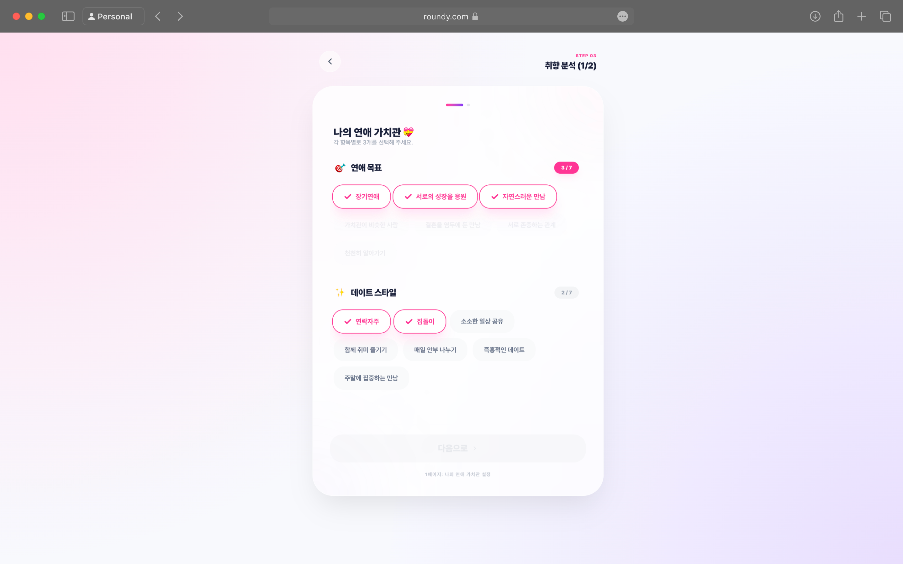
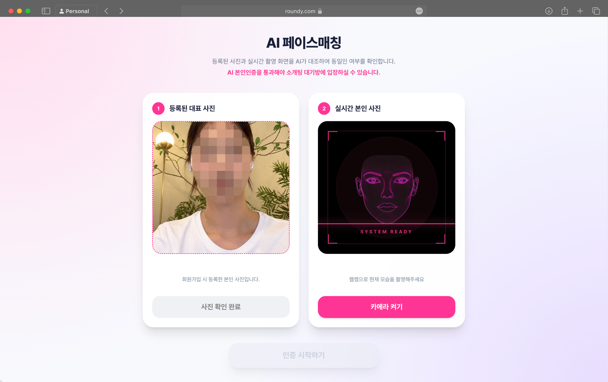
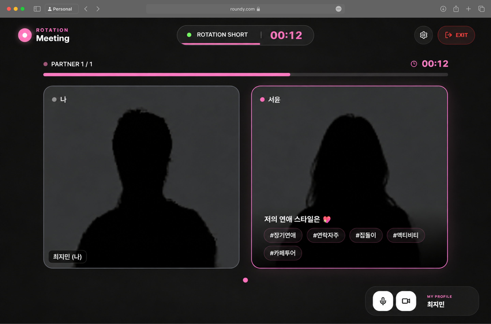
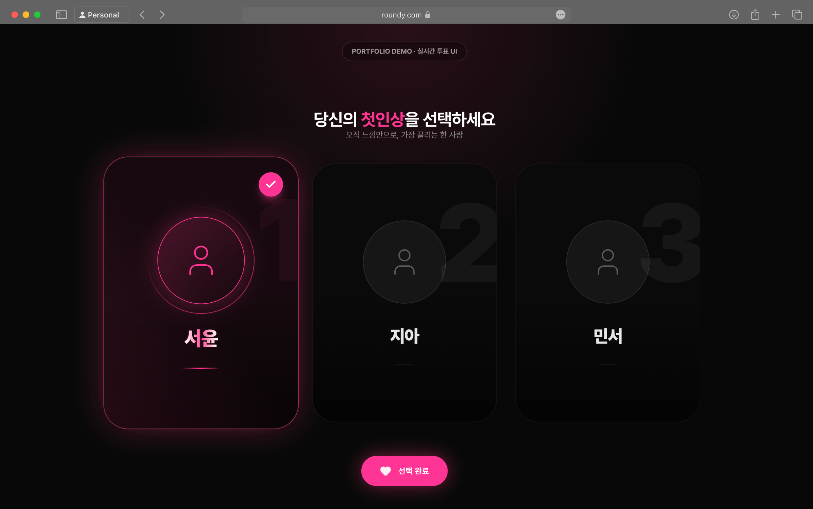

# Roundy · 라운디

> **대화로 시작하는 온라인 로테이션 소개팅**

## 🎉 프로젝트 소개

Roundy는 여러 사람과 차례로 화상 대화를 나누고, 서로의 선택을 통해 만남을 이어가는 온라인 로테이션 소개팅 서비스입니다.

카카오 로그인과 프로필 설정부터 얼굴 인증, 매칭 대기, 화상 미팅, 최종 선택과 쪽지까지 하나의 흐름으로 연결했습니다.

---

## ✨ 주요 기능

### 1. 로그인 · 프로필 설정
> **Kakao Login · JWT · Spring Security**

카카오 계정으로 로그인하고 닉네임, 자기소개와 선호 정보를 등록합니다.

### 2. 얼굴 인증
> **Flask · DeepFace · ArcFace · OpenCV**

기준 이미지와 카메라 이미지를 비교합니다. 밝기·대비와 얼굴 검출 여부를 확인하고 얼굴 유사도를 판단합니다.

### 3. 실시간 로테이션 미팅
> **Redis · WebSocket · OpenVidu · WebRTC**

매칭 대기를 거쳐 화상 미팅에 입장합니다. 자기소개와 첫인상 투표, 1:1 로테이션 대화, 최종 투표 순으로 진행하며 서버가 단계와 타이머를 관리합니다.

### 4. 매칭 결과 · 쪽지
> **Spring Data JPA · MySQL**

서로 선택한 상대와 쪽지방에서 대화를 이어갑니다. 대화방 참여 권한과 나가기 상태를 관리합니다.

---

## 🎬 단계별 미팅 진행

> **실루엣으로 먼저 대화하고, 로테이션을 거쳐 서로를 선택한 뒤 얼굴을 공개합니다.**
>
> 아래는 현재 `master`의 실제 자동 전환 흐름입니다. 대기·휴식을 제외하면 **7개 주요 단계**로 진행됩니다.

```text
참가자 대기
  ↓
자기소개 → 첫인상 투표 → 짧은 1:1 대화 → 긴 1:1 대화
  ↓
최종 투표 → 매칭 결과 → 매칭된 상대와 얼굴 공개
  ↓
미팅 종료 · 쪽지로 대화 이어가기
```

| 단계 | 참가자 경험 | 화면·영상 처리 |
| :--- | :--- | :--- |
| ① 자기소개 | 참가자가 한 명씩 차례로 자기소개합니다. | `SILHOUETTE` 모드로 실루엣을 표시합니다. |
| ② 첫인상 투표 | 첫인상으로 마음에 드는 상대를 선택합니다. 이후 휴식 구간에서 투표 결과를 보여줍니다. | 영상은 `BLACK` 모드로 전환하고 투표 화면을 표시합니다. |
| ③ 짧은 1:1 대화 | 라운드마다 상대를 바꿔가며 1:1로 대화합니다. | 실루엣 상태로 대화합니다. |
| ④ 긴 1:1 대화 | 다시 상대를 순환하며 더 긴 대화를 진행합니다. | `NOSE_MASK` 모드로 코 위치 위쪽을 가리고 아래쪽을 보여줍니다. |
| ⑤ 최종 투표 | 대화를 마친 뒤 최종 상대를 선택합니다. | 최종 선택 화면을 표시합니다. |
| ⑥ 매칭 결과 | 서로를 선택한 경우에만 매칭이 성립하며 결과를 저장합니다. | 성공·실패 결과를 구분해 안내합니다. |
| ⑦ 얼굴 공개 | 매칭된 두 사람을 별도의 영상 세션으로 연결합니다. 매칭되지 않은 참가자에게는 종료를 안내합니다. | `NORMAL` 모드로 얼굴을 공개합니다. |

### 라운드와 단계 동기화

- **3:3 참여 기준**, 짧은 대화 3라운드와 긴 대화 3라운드를 진행합니다. 같은 단계 안에서 상대를 바꿀 때도 휴식 구간을 둡니다.
- 자기소개는 참가자별로 한 차례씩 진행하고, 주요 단계 사이에는 `BREAK` 상태를 사용합니다.
- 서버가 단계와 순서를 관리하고, 클라이언트의 화면 준비 완료 신호 또는 대기 제한시간 이후 타이머를 시작합니다.
- 마지막 얼굴 공개 시간이 끝나면 미팅과 방을 정리합니다. 매칭된 상대와의 쪽지는 별도 화면에서 이어갑니다.

<details>
<summary><b>현재 코드의 시연 시간과 비활성 단계</b></summary>

현재 `Stage`에 설정된 값은 **시연·테스트용**이며, 실제 서비스 운영 시간으로 소개하지 않습니다.

| 항목 | 현재 설정 |
| :--- | :--- |
| 자기소개 | 참가자당 10초 |
| 첫인상 투표 | 10초 |
| 짧은 1:1 대화 | 라운드당 20초 |
| 긴 1:1 대화 | 라운드당 30초 |
| 최종 투표 | 10초 |
| 매칭 결과 | 10초 |
| 얼굴 공개 | 15초 |
| 단계·라운드 사이 휴식 | 10초 |

화면 준비 대기와 결과 연출 시간이 별도로 있어 위 시간을 더한 값이 전체 이용 시간과 같지는 않습니다.

`IMAGE_GAME`은 enum과 관련 구현이 남아 있지만, 현재 자동 전환은 `ROTATION_SHORT → ROTATION_LONG`으로 이어지며 실행 분기에도 포함되지 않습니다. 따라서 현재 이용 흐름에는 이미지 게임을 포함하지 않았습니다.

</details>

---

## 🖥 서비스 화면 예시

### 선호 정보 설정



### 얼굴 인증



### 실루엣 미팅



### 첫인상 투표



---

## 🛠 기술 스택

| 구분 | 기술 |
| :--- | :--- |
| Frontend | React 19, TypeScript, Vite, Tailwind CSS |
| Backend | Java 21, Spring Boot 3.5.9, Spring Data JPA |
| 인증 | Kakao Login, Spring Security, JWT |
| 실시간 통신 | WebSocket, WebRTC, OpenVidu |
| 얼굴 인증 | Python, Flask, DeepFace, ArcFace, OpenCV |
| 데이터 저장 | MySQL, Redis, MinIO |
| 실행 환경 | Docker, Docker Compose |

## 📁 프로젝트 구조

```text
Roundy/
├── Frontend/    # 사용자 화면
├── Backend/     # API·매칭·실시간 미팅
├── AI/          # 얼굴 인증
├── Infra/       # 인프라 설정
├── docs/        # 설계·검증 기록
└── exec/        # 실행 안내·시연 시나리오
```
